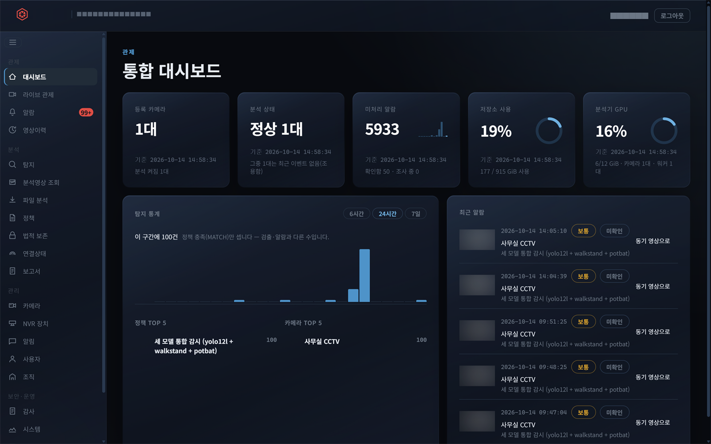
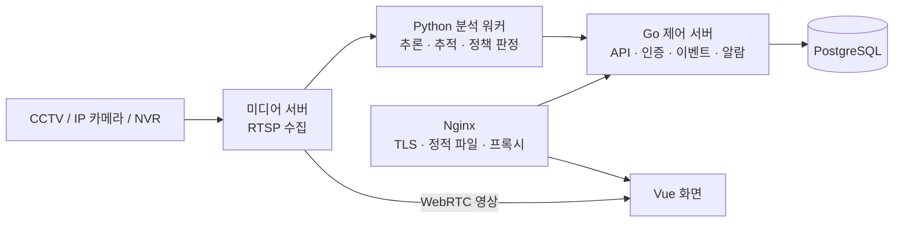
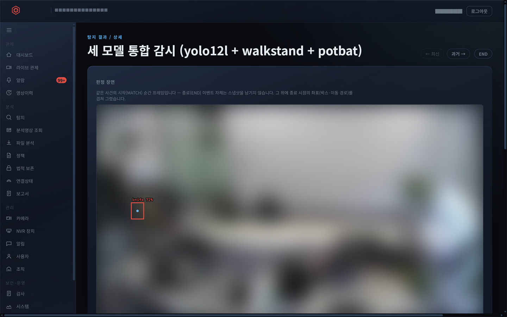
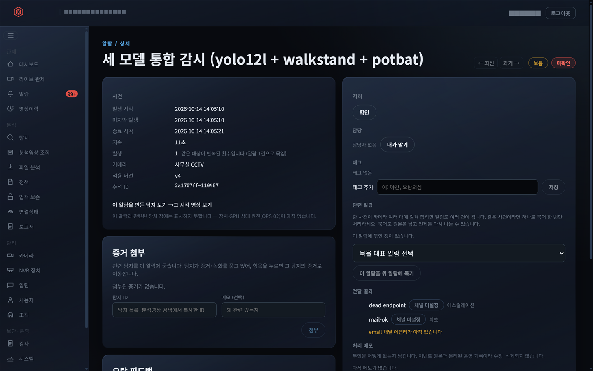
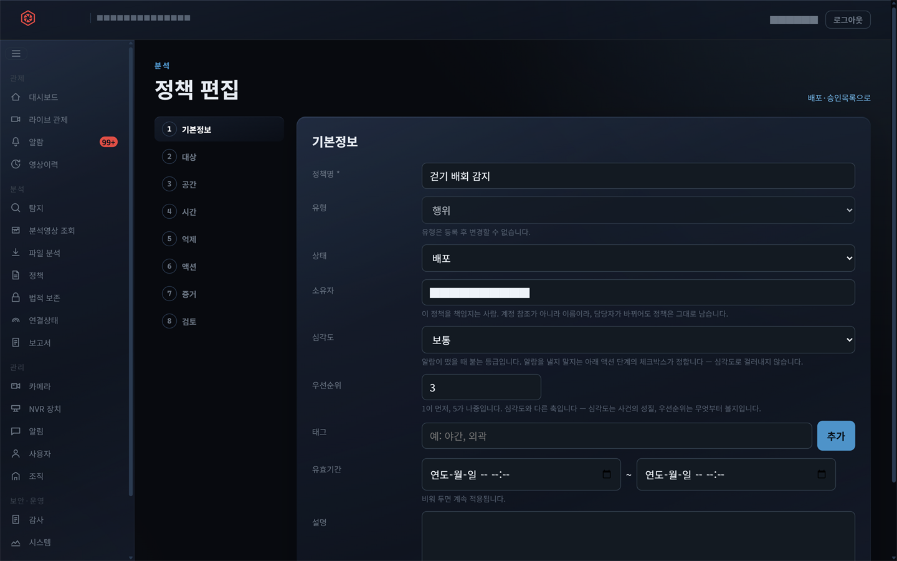
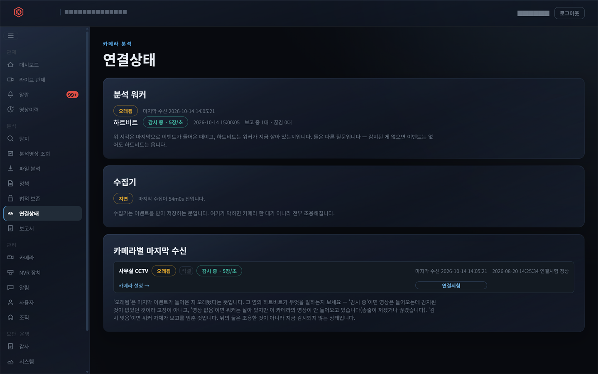
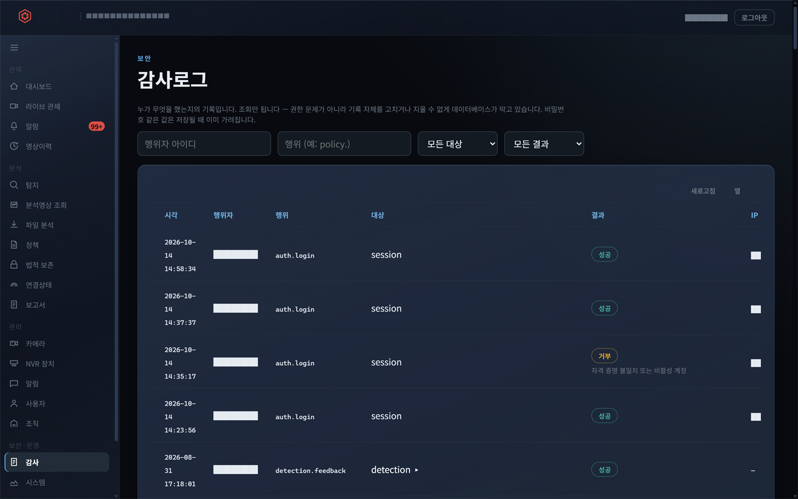

# CCTV 영상분석 관제 시스템 재작성

기존 PHP 관제 시스템을 대체하기 위해 **Vue 3 + Go**로 새로 만든 온프레미스 영상분석 관제 시스템입니다.
화면(UI)부터 제어 서버, 분석 워커 연동, DB까지 혼자 만들었고, 실제 서버에 설치해 사무실 CCTV로
동작을 확인했습니다.

> 사내 프로젝트라 소스 코드는 공개하지 않습니다. 화면 사진의 사람·회사 이름, IP·주소, 장비 이름은 가렸고,
> 카메라 영상·사진은 흐리게 처리했습니다.

## 한눈에

| | |
|---|---|
| 기간 | 2026년 7월 말 ~ 8월 (약 4주) |
| 역할 | 1인 개발 — 화면 설계·구현, 제어 서버(API), 분석 워커 연동, DB, 배포 |
| 규모 | 화면 41개 · API 115개 · 설계 결정 기록(ADR) 35건 |
| 품질 | 배포 전 전수 코드 검토로 치명·중대 결함 41건 차단 |

## 기술 스택

| 계층 | 스택 | 역할 |
|---|---|---|
| 화면 | Vue 3 · TypeScript(strict) · Vite · TanStack Query · Pinia | 관제·정책·알람·검색 화면 |
| 제어 서버 | Go `net/http` | 인증·권한·정책·이벤트 수집·알람 |
| 미디어 | MediaMTX | RTSP 수집, WebRTC 실시간 영상, 녹화·재생 |
| 분석 | Python 워커 | 프레임 추론·정책 판정 |
| 저장 | PostgreSQL | 기존 시스템의 DB 구조를 그대로 옮겨, 기존 분석 엔진을 고치지 않고 갈아탈 수 있게 |

## 화면

### 통합 대시보드

카메라·분석 상태·미처리 알람·저장소·GPU를 한 화면에 모았습니다. 탐지 통계가 무엇을 세는지(정책 충족 건만)를
화면에 적어 둡니다 — 검출·이벤트·알람은 서로 다른 수라서 섞지 않습니다.

### 탐지 상세

판정 장면 위에 탐지 박스와 신뢰도를 겹쳐 그립니다. 종료 이벤트는 스냅샷이 없어서 같은 사건의 시작 프레임을
대신 보여 주고, 그 사실을 화면에 적습니다. ←/→ 키로 앞뒤 탐지를 오갑니다.

### 알람 상세

사건 정보와 그때 적용된 정책 버전, 담당 지정·태그·관련 알람 묶기·전달 결과를 한 곳에서 처리합니다.
처리 메모는 이벤트 원본과 분리된 운영 기록이라 고치거나 지울 수 없습니다.

### 정책 편집

기본정보 → 대상 → 공간 → 시간 → 억제 → 액션 → 증거 → 검토, 8단계로 감지 정책을 만듭니다.

### 연결상태

"마지막 이벤트가 오래됨"과 "분석 워커가 살아 있음(하트비트)"을 따로 보여 줍니다. 감지된 게 없어서 조용한 것과
고장 나서 조용한 것을 구분하기 위해서입니다.

### 감사로그

누가 언제 무엇을 했는지 남깁니다. 거부된 로그인도 기록되고, 기록 자체는 데이터베이스가 수정·삭제를 막습니다.

## 화면을 만들며 지킨 것

**화면이 사실과 다르게 말하지 않게.** 이 제품의 원칙입니다. 완성 후 30개 화면을 DB·서버 실측값과 하나씩
대조해, 사실과 다르게 표시하던 곳을 찾아 고쳤습니다.
- 영상이 아예 들어오지 않는 카메라를 "감시 중"으로 표시하던 것 → "영상 없음" 상태를 따로 만들었습니다.
- 브라우저 기본 재생 막대가 천 분이 넘는 녹화를 "0:02"로 보여 주던 것 → 녹화 구간 전체를 아는 재생 막대를
  직접 그렸습니다.

**API 명세를 먼저.** API를 바꿀 때는 명세(OpenAPI)를 먼저 고치고, 거기서 TypeScript 타입을 자동 생성해
화면이 씁니다. 서버와 화면의 데이터 모양이 어긋나면 빌드 단계에서 걸립니다.

**공통 부품은 직접.** 상용 라이선스가 필요한 UI 라이브러리(PrimeVue)를 걷어내고 표·상태 표시·배지 같은
공통 부품을 직접 만들었습니다. 색과 간격은 디자인 토큰으로만 씁니다.

**모바일에서도.** 폰에서 열어 보니 화면 8개가 옆으로 넘쳤습니다. 원인 5가지를 모두 고치고, 넘침 여부를
자동 화면 검사(e2e)에 상시로 넣었습니다.

**검사가 실제로 도는지 확인.** 번역 누락을 잡는 자동 검사가 정규식 실수로 만든 이래 한 번도 동작하지 않고
늘 통과로만 나오던 것을 찾아 고쳤고, 그 뒤 실제 누락 1건을 잡았습니다.

## 소스 코드

사내 프로젝트라 공개하지 않습니다. 필요하시면 비공개 저장소로 보여 드릴 수 있습니다.
