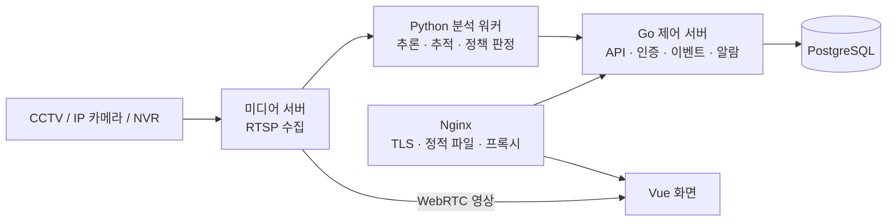

# CCTV 관제 시스템 재작성

`Vue 3` `TypeScript` `Go` `PostgreSQL` `MediaMTX` · 2026.07–08 · 1인 개발

회사에서 쓰던 PHP 관제 시스템을 대체하려고 새로 만든 영상분석 관제 시스템입니다.
화면부터 제어 서버, 분석 워커 연동, DB까지 혼자 맡았고, 실제 서버에 설치해서 사무실 CCTV로 돌려 봤습니다.

- 화면 41개, API 115개
- 설계 결정 기록(ADR) 35건
- 배포 전 코드 전수 검토에서 치명·중대 결함 41건을 찾아 막음

사내 프로젝트라 코드는 공개하지 않습니다. 사진 속 사람·회사 이름, IP, 장비 이름은 가렸고 카메라 영상은 흐리게 처리했습니다.

## 구조

| 계층 | 스택 | 하는 일 |
|---|---|---|
| 화면 | Vue 3, TypeScript(strict), Vite, TanStack Query, Pinia | 관제, 정책, 알람, 검색 |
| 제어 서버 | Go `net/http` | 인증, 권한, 정책, 이벤트 수집, 알람 |
| 미디어 | MediaMTX | RTSP 수집, WebRTC 실시간 영상, 녹화와 재생 |
| 분석 | Python 워커 | 프레임 추론, 정책 판정 |
| 저장 | PostgreSQL | 기존 DB 구조를 그대로 옮겨서 기존 분석 엔진을 고치지 않고 갈아탈 수 있게 함 |

## 화면

**탐지 상세.** 판정 장면 위에 탐지 박스와 신뢰도를 겹쳐 보여 줍니다. 종료 이벤트에는 스냅샷이 없어서 같은 사건의 시작 프레임을 대신 띄우고, 화면에도 그렇게 적어 둡니다. 키보드 ←/→로 앞뒤 탐지를 넘길 수 있습니다.

**알람 상세.** 사건 정보, 그때 적용된 정책 버전, 담당자 지정, 태그, 관련 알람 묶기, 알림 전달 결과를 한 화면에서 처리합니다. 처리 메모는 원본 이벤트와 따로 저장돼서 나중에 고치거나 지울 수 없습니다.

**정책 편집.** 기본정보, 대상, 공간, 시간, 억제, 액션, 증거, 검토 순서로 8단계에 걸쳐 감지 정책을 만듭니다.

**연결상태.** 마지막 이벤트 시각과 분석 워커의 하트비트를 따로 보여 줍니다. 아무 일이 없어서 조용한 건지, 고장 나서 조용한 건지 구분하려고 나눴습니다.

**감사로그.** 누가 언제 무엇을 했는지 남깁니다. 거부된 로그인도 기록되고, 기록은 DB 단에서 수정과 삭제를 막아 두었습니다.

## 만들면서 신경 쓴 것

가장 신경 쓴 건 화면이 사실과 다르게 표시되지 않게 하는 것이었습니다. 다 만든 뒤 30개 화면을 DB와 서버 실측값에 하나씩 대조해 봤는데, 영상이 아예 안 들어오는 카메라가 "감시 중"으로 떠 있었고 천 분이 넘는 녹화가 브라우저 기본 재생 막대에서 "0:02"로 보였습니다. 앞의 것은 "영상 없음" 상태를 따로 만들어서, 뒤의 것은 녹화 구간 전체를 아는 재생 막대를 직접 그려서 고쳤습니다.

API를 바꿀 때는 OpenAPI 명세를 먼저 고치고, 거기서 TypeScript 타입을 생성해 화면에서 썼습니다. 서버와 화면의 데이터 모양이 어긋나면 빌드할 때 바로 걸립니다.

처음에는 PrimeVue를 썼는데 상용 라이선스 문제가 있어서 걷어내고, 표나 상태 표시, 배지 같은 공통 부품을 직접 만들었습니다. 색과 간격은 디자인 토큰으로만 지정했습니다.

폰으로 열어 보니 화면 8개가 옆으로 넘쳤습니다. 원인이 다섯 가지였고, 다 고친 뒤 넘침 여부를 e2e 검사에 넣어 매번 확인하게 했습니다.

30개 화면을 대조하던 중에, e2e에 있던 번역 누락 검사가 정규식 실수 때문에 처음부터 한 번도 제대로 돌지 않고 통과만 하고 있었다는 것도 알게 됐습니다. 고치고 나니 실제로 빠진 번역이 1건 나왔습니다.
