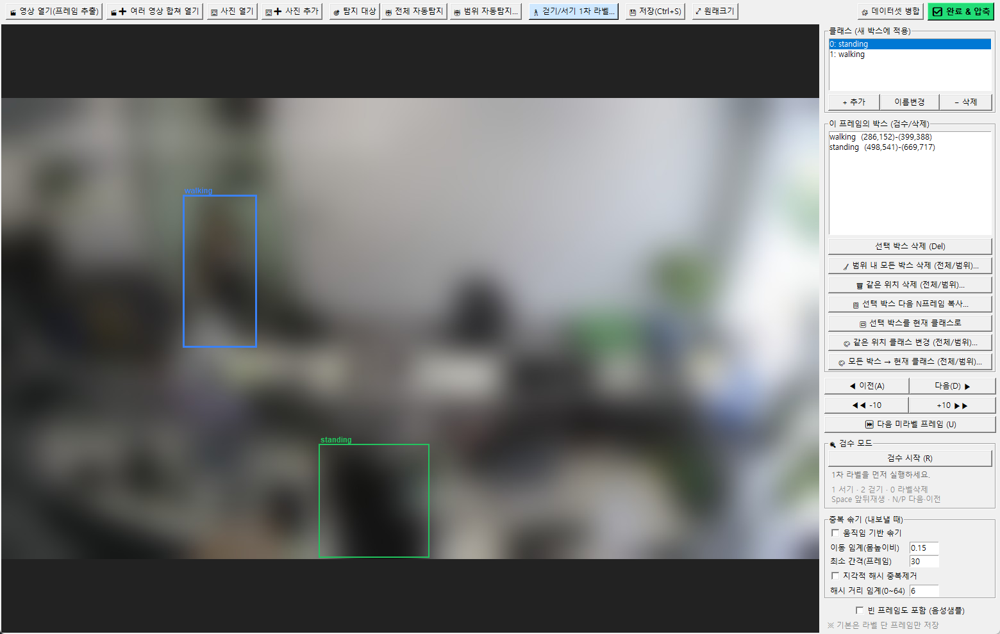

# CCTV 라벨링 도구

실제 도구 화면입니다. 사람이 드러나지 않도록 영상 장면은 전체를 흐리게 했고, 박스와 라벨은 화면 구성을 보여 주기 위한 예시입니다.

CCTV 영상을 넣으면 **프레임 이미지 + 박스 라벨**을 만들고, **YOLO로 바로 학습할 수 있는 데이터셋**(train/val 분리,
`data.yaml`, zip)으로 내보내는 데스크톱 도구입니다. 걷기·서기 판정 모델을 만들다가 필요해서 만들었고,
걷기·서기 판정과 화분·야구방망이 탐지의 학습·검수 데이터를 이 도구로 만들었습니다.

> 사내 작업에 쓰려고 만든 도구라 소스 코드는 비공개 저장소에 있습니다.

## 한눈에

| | |
|---|---|
| 기간 | 2026년 7~8월 |
| 역할 | 1인 개발 — 기획, 구현, 실제 라벨링 작업에 사용 |
| 스택 | Python · Tkinter · OpenCV · Ultralytics YOLO12 |
| 구성 | 자동 라벨링(영상 → 프레임 → YOLO 자동 라벨 → 데이터셋) + 수동 라벨링·검수 도구 |
| 배포 | Windows 실행 파일(.exe)로도 묶어 파이썬 설치 없이 실행 |

## 왜 만들었나

상용 라벨링 도구는 CCTV 작업 흐름과 맞지 않았습니다. 아래 네 가지가 전부 손으로 하는 일이었습니다.

| 손으로 하던 일 | 도구에서 |
|---|---|
| 영상에서 프레임을 뽑아 따로 불러오기 | 영상을 열면 바로 프레임 추출 (전 프레임 / N프레임 간격 / 초당 N장) |
| 가만히 서 있는 사람을 수십 프레임 반복해서 그리기 | 선택한 박스를 다음 N프레임에 복사 |
| 여러 프레임에 걸친 같은 자리 오탐 박스 지우기 | 같은 위치의 박스를 범위 안에서 한 번에 삭제·클래스 변경 |
| 1차 라벨이 맞는지 한 장씩 눈으로 확인 | 검수 모드 (아래) |

## 주요 기능

- **AI 자동 탐지:** YOLO로 박스를 미리 깔아 두고 사람은 고치기만 합니다. 이미 박스가 있는 자리는 건너뜁니다.
- **박스 편집:** 드래그로 그리기·이동·크기 조절, 휠 확대(커서 기준), 우클릭 이동, 되돌리기.
- **키보드 중심:** `A`/`D` 앞뒤, `PageUp`/`PageDown` ±10, `U` 다음 미라벨 프레임, `1`~`9` 클래스 선택.
  한글 입력 상태에서도 단축키가 먹도록 처리했습니다.
- **자동 저장·이어하기:** 모든 변경을 바로 저장해서, 도구를 닫았다가 같은 폴더를 열면 이어서 작업합니다.
- **내보낼 때 중복 솎기:** 거의 같은 프레임이 많으면 학습에 도움이 안 되므로, 움직임 기준(몸 높이 대비 이동량)과
  이미지 해시(dHash) 기준으로 비슷한 프레임을 덜어 냅니다.
- **YOLO 표준 출력:** 이미지와 라벨을 항상 1:1로 맞추고(객체 없는 프레임도 빈 라벨), train/val 분할과 `data.yaml`을 자동으로 만듭니다.

## 검수 모드

1차 라벨(자동 탐지나 이전 작업분)을 **키보드만으로 빠르게 확인**하는 모드입니다. 켜면 오른쪽 패널이 접히고
이미지가 화면 대부분을 차지하며, 판정할 박스만 강조되고 나머지는 흐려집니다. 재생과 슬라이더로 구간을 넘기며
판정하면 결과가 그대로 라벨에 반영됩니다.

라벨을 **만드는 것보다, 만들어진 라벨을 믿을 수 있는지 확인하는 데** 시간이 더 든다는 걸 직접 겪고 나서 추가했습니다.
