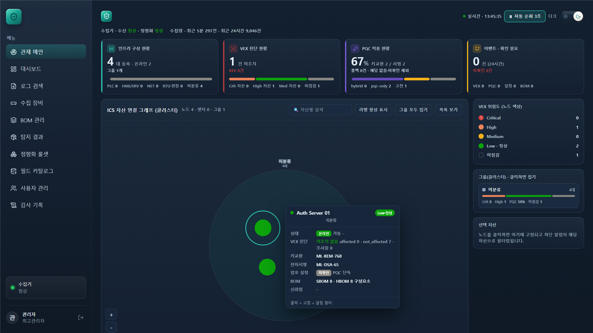
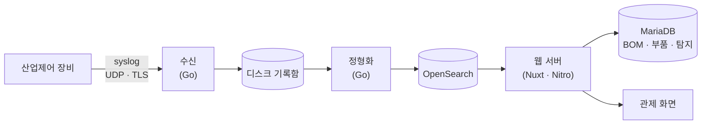
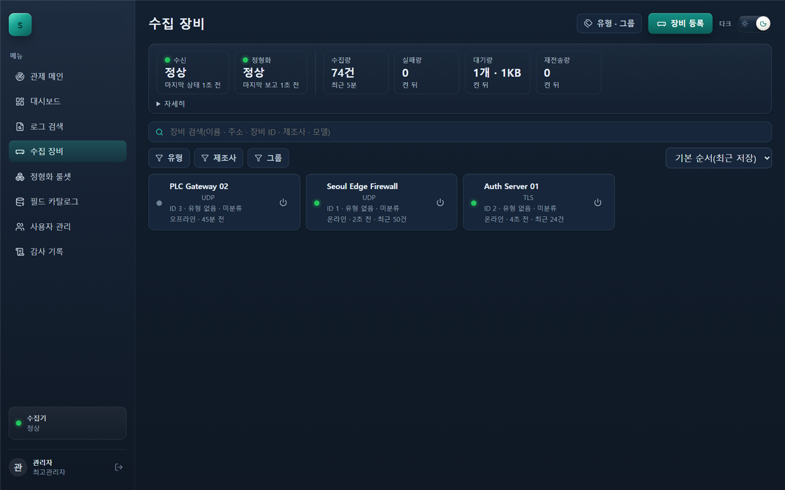

# 산업제어 장비 SBOM·HBOM 수집·관제 플랫폼

`Go` `Nuxt` `TypeScript` `OpenSearch` `MariaDB` `CycloneDX 1.7` `ECharts` · 2026.09– (진행 중) · 팀 플랫폼 개발

산업제어 장비가 보내는 로그와 소프트웨어·하드웨어 구성 목록(SBOM·HBOM)을 모아, 장비 구성에 새 부품이 생기면 찾아내는 보안 관제 플랫폼입니다. 연구 과제로 진행 중인 팀 프로젝트에 합류해 수집기부터 화면까지 맡았습니다.

| | |
|---|---|
| 맡은 일 | 수집기(Go), BOM 검증·저장, 새 부품 탐지, 반복시험 결과표, 관제 메인, 장비·BOM·감사 기록 화면 |
| 규모 | 합류 뒤 6주 동안 팀 커밋 60개 중 58개, 병합된 MR 53건 (2026-11-06 기준) |
| 수집 안정성 | 받은 기록을 디스크에 먼저 쌓고 저장하는 구조로 바꿈. UDP 초당 5,000건을 60초 보내 버린 기록 0건 |
| 핵심 기능 | 기준 구성과 새로 받은 BOM을 비교해 추가된 부품을 찾고, 정답지와 대조해 탐지 성공률을 계산 |
| 일한 방식 | 결함은 고치기 전에 재현부터, 결정마다 근거(규격·지시·실측)를 나눠 기록, 자동 리뷰 지적은 실제 동작과 대조해 판단 |

사내 프로젝트라 코드는 공개하지 않습니다. 사진은 시험용 데이터로 찍었고 기관·고객사 이름과 IP는 가렸습니다.

## 구조

수집 장비 화면입니다. 수신·정형화 두 프로세스의 상태와 수집량·실패량·대기량·재전송량, 장비별 마지막 수신 시각을 보여 줍니다.

## 만든 것

**수집기.** 장비가 syslog로 보내는 기록을 받아 정형화해 저장합니다. 받는 쪽과 정형화하는 쪽을 두 프로세스로 나누고, 받은 기록은 번호를 붙여 디스크에 먼저 쌓게 했습니다. 저장소가 멈춰도 기록은 남고, 저장소가 받지 못하는 기록 한 건이 그 뒤 기록을 막지 않습니다. 수집기 상태는 30초마다 웹 서버에 보고해 화면에 보입니다.

**BOM 검증·저장.** 받은 CycloneDX 1.7 문서를 공식 스키마로 검증하고, 부품과 부품 사이 관계 단위로 저장합니다. 결과는 저장됨, 중복, 장비 미등록, 양식 오류 네 가지로 나뉘고, 잘못된 문서도 버리지 않고 사유와 함께 남깁니다.

**새 부품 탐지와 반복시험.** 장비마다 기준 구성을 두고, 새로 받은 BOM과 비교해 추가된 부품을 찾습니다. 시험용 변경 전·후 구성과 정답지를 만들고, 회차를 돌려 보낸 뒤 탐지 결과를 정답지와 대조해 성공률을 계산하는 결과표까지 만들었습니다.

**관제 메인과 화면.** 예시 데이터로만 돌던 관제 메인을 실제 등록 장비와 수집 상태에 연결했습니다. 장비별 BOM 보기(버전 비교, 내보내기), 장비 연결 관계, 감사 기록 화면을 만들었고, 대시보드에서 차트를 직접 추가하는 기능도 넣었습니다.

만들면서 있었던 일

 

수집부를 보완하다가 문제를 여럿 찾았습니다. TLS로 받는 기록을 줄바꿈으로만 나눠서 표준 방식(길이 표시)으로 보내는 장비의 기록이 깨졌고, 시각을 UTC로 읽어 9시간이 어긋났습니다. 같은 이름을 쓰는 장비가 여럿이면 모두 첫 장비로 연결되는 문제도 있었습니다. 모두 고치기 전 코드에서 테스트로 재현한 뒤 고쳤습니다.

관제 메인을 실제 데이터에 연결할 때는, 출처가 없는 값은 지어내지 않기로 했습니다. 그룹·위험도처럼 아직 데이터가 없는 칸은 "미분류", "미점검"으로 보여 줍니다. 기본 대시보드 카드 중에는 근거로 설명할 수 없는 숫자(성공률 0, 총 건수와 같은 미일치 건수)가 있어서, 저장소에 직접 센 값과 하나씩 맞춰 고쳤습니다.

DB가 저장을 거절하거나 연결이 끊겨도 화면에는 성공처럼 보이는 구조가 있었습니다. 장비·룰셋·대시보드 저장이 모두 같은 구조여서 한 번에 고쳐, 실패가 화면에 드러나게 했습니다.

