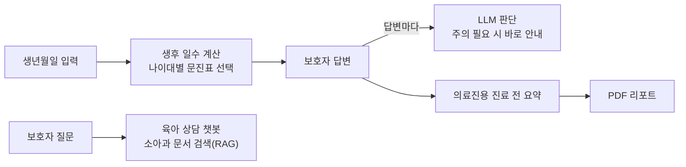

# 소아과 사전 문진 AI 에이전트

`LangChain` `GPT-4o-mini` `ChromaDB` `Streamlit` · 2025.10–11 · 학부 연구생, 에이전트 메인 개발

보호자가 진료 전에 아이 상태를 입력하면 나이에 맞는 문진표를 띄우고, 답변 중 진료 때 주의가 필요한 내용은 그 자리에서 알려 주고, 의료진에게는 진료 전 요약을 만들어 주는 AI 에이전트입니다.
실제 소아청소년과 병원의 사전 문진 자료를 바탕으로 만들었습니다.

- 문진 흐름, 답변별 LLM 판단과 요약, RAG 챗봇, PDF 리포트를 맡았습니다
- 한국어와 영어 두 버전
- 그 밖에 Python, Pydantic, ReportLab 사용

코드: [tommyoon0827/Pediatric_previsit_ai_agent](https://github.com/tommyoon0827/Pediatric_previsit_ai_agent)

## 흐름

## 기능

<!-- 사진 넣는 법: 사진 파일을 docs/ 폴더에 아래 이름으로 넣고, 각 사진 줄 앞뒤의 주석 기호를 지우세요. -->

**나이별 문진표.** 생년월일로 생후 일수를 계산해서 "14–35일", "4–6개월" 같은 나이대 문진표를 자동으로 고릅니다. 문진표는 버전을 붙인 JSON 파일로 따로 두고 Pydantic으로 검증해서, 질문 내용을 고칠 때 코드를 건드리지 않아도 되게 했습니다.

<!--  -->

**답변마다 바로 안내.** 아이의 개월 수와 질문, 답변을 LLM이 함께 보고 진료 때 주의가 필요한지 판단해서, 그 자리에서 보호자에게 알려 줍니다.

<!--  -->

**의료진용 요약.** 문진 결과 중 의미 있는 답변만 추려서 의료진이 진료 전에 읽을 요약을 만듭니다.

<!--  -->

**육아 상담 챗봇.** 소아과 문서를 ChromaDB로 벡터 검색하고, 찾은 내용을 근거로 답하는 RAG 챗봇입니다.

<!--  -->

**PDF 리포트.** 아이 정보와 답변, 요약을 보호자와 의료진이 내려받을 수 있는 PDF로 만듭니다.

<!--  -->
