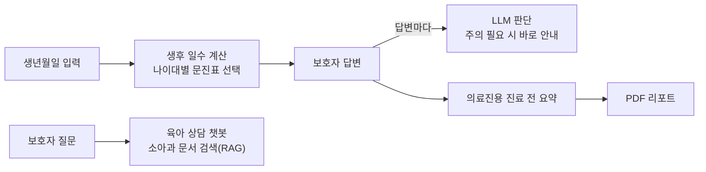

# 소아과 사전 문진 AI 에이전트

보호자가 진료 전에 아이의 상태를 입력하면, **나이에 맞는 문진표**를 띄우고, 답변 중 진료 때 주의가 필요한 내용을
**바로 알려 주고**, 의료진에게는 **진료 전 요약**을 만들어 주는 AI 에이전트입니다.
실제 소아청소년과 병원의 사전 문진 자료를 바탕으로 만들었습니다.

→ 코드: [tommyoon0827/Pediatric_previsit_ai_agent](https://github.com/tommyoon0827/Pediatric_previsit_ai_agent)

## 한눈에

| | |
|---|---|
| 기간 | 2025년 10~11월 (학부 연구생) |
| 역할 | AI 에이전트 메인 개발 — 문진 흐름, LLM 판단·요약, RAG 챗봇, 리포트 |
| 스택 | Python · Streamlit · LangChain · OpenAI GPT-4o-mini · ChromaDB · Pydantic · ReportLab |
| 언어 | 한국어·영어 두 버전 |

## 흐름

<!-- 사진 넣는 자리: 사진 파일을 docs/ 폴더에 아래 이름으로 넣고, 해당 줄을 감싼 주석 기호를 지우세요.
## 화면

### 나이별 문진표

### 답변마다 바로 안내

### 의료진용 진료 전 요약

### 육아 상담 챗봇

### PDF 리포트

-->

## 주요 기능

- **나이에 맞는 문진표:** 생년월일로 생후 일수를 계산해 "14~35일", "4~6개월" 같은 나이대 문진표를 자동으로 고릅니다.
  문진표는 버전이 붙은 JSON 파일로 따로 두고 Pydantic으로 검증해, 질문 내용과 코드를 분리했습니다.
- **답변마다 바로 안내:** 아이의 개월 수·질문·답변을 LLM이 함께 보고 진료 때 주의가 필요한지 판단해, 그 자리에서 보호자에게 알립니다.
- **의료진용 요약:** 문진 결과에서 의미 있는 답변만 추려 의료진이 진료 전에 읽을 요약을 만듭니다(임상 의사결정 지원).
- **육아 상담 챗봇:** 소아과 문서를 벡터 검색(ChromaDB)해서 그 근거로 답하는 RAG 챗봇입니다.
- **PDF 리포트:** 아이 정보·답변·요약을 보호자와 의료진이 내려받을 수 있는 PDF로 만듭니다.
