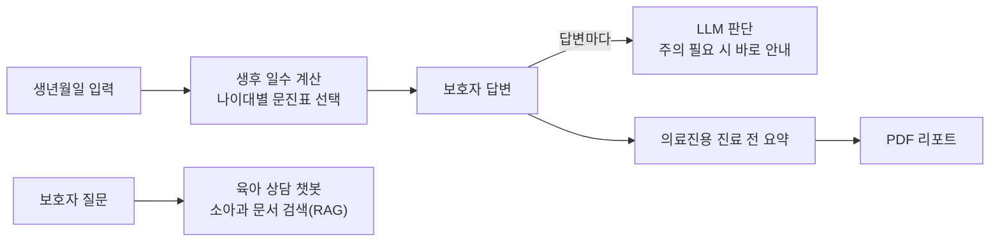

# 소아과 사전 문진 AI 에이전트

`LangChain` `GPT-4o-mini` `ChromaDB` `Streamlit` · 2025.10–11 · 학부 연구생, 에이전트 메인 개발

보호자가 진료 전에 아이 상태를 입력하면 나이에 맞는 문진표를 띄우고, 답변 중 진료 때 주의가 필요한 내용은 그 자리에서 알려 주고, 의료진에게는 진료 전 요약을 만들어 주는 AI 에이전트입니다.
실제 소아청소년과 병원의 사전 문진 자료를 바탕으로 만들었습니다.

- 문진 흐름, 답변별 LLM 판단과 요약, RAG 챗봇, PDF 리포트를 맡았습니다
- 한국어와 영어 두 버전
- 그 밖에 Python, Pydantic, ReportLab 사용
- 답변별 안내를 병원 기준 80건으로 평가: 재현율 93.3%, 오경보 6.7% (2026년 11월 추가)

코드: [tommyoon0827/Pediatric_previsit_ai_agent](https://github.com/tommyoon0827/Pediatric_previsit_ai_agent)

## 흐름

## 기능

<!-- 사진 넣는 법: 사진 파일을 docs/ 폴더에 아래 이름으로 넣고, 각 사진 줄 앞뒤의 주석 기호를 지우세요. -->

**나이별 문진표.** 생년월일로 생후 일수를 계산해서 "14–35일", "4–6개월" 같은 나이대 문진표를 자동으로 고릅니다. 문진표는 버전을 붙인 JSON 파일로 따로 두고 Pydantic으로 검증해서, 질문 내용을 고칠 때 코드를 건드리지 않아도 되게 했습니다.

<!--  -->

**답변마다 바로 안내.** 문항마다 병원 자료의 판정 기준과 권고 조치를 함께 보여 주고, 그 위에 LLM이 아이의 개월 수와 질문, 답변을 보고 진료 때 주의가 필요한지 판단해 그 자리에서 짧은 안내를 띄웁니다.

<!--  -->

**의료진용 요약.** 문진 결과 중 의미 있는 답변만 추려서 의료진이 진료 전에 읽을 요약을 만듭니다.

<!--  -->

**육아 상담 챗봇.** 소아과 문서를 ChromaDB로 벡터 검색하고, 찾은 내용을 근거로 답하는 RAG 챗봇입니다.

<!--  -->

**PDF 리포트.** 아이 정보와 답변, 요약을 보호자와 의료진이 내려받을 수 있는 PDF로 만듭니다.

<!--  -->

## 평가

LLM이 띄우는 즉시 안내가 병원 기준과 맞는지, 평가셋을 직접 만들어 쟀습니다.

| | |
|---|---|
| 평가셋 | 병원 기준으로 정답을 붙인 80건 (문항 40개 × 문제가 되는 답 / 정상인 답) |
| 지금 앱 | 문제가 되는 답의 93.3%에 경고, 정상인 답의 6.7%에 잘못 경고 |
| 원인 | 2개 문항에서 "예"와 "아니오"를 거꾸로 판단 |
| 프롬프트 개선 2번 | 놓치는 건 0%까지 줄었지만 오경보가 늘었고, 오경보를 줄이면 다시 놓침 |
| 결론 | 선택형 문항의 안내는 병원 기준을 그대로 따르게 하고, LLM은 서술형 답과 안내 문장에 쓰는 구조로 바꿔야 함 |

평가 방법과 자세한 결과

 

앱은 문항마다 병원 자료의 판정 기준과 권고 조치를 그대로 보여 줍니다. 평가 대상은 그 위에 LLM이 판단해서 띄우는 즉시 안내입니다. 문진표의 단일 선택 문항 196개 중 병원 기준이 분명한 40개를 골랐고, 정답은 제가 정하지 않고 문진표에 들어 있는 병원 기준 문장을 근거로 붙였습니다. 프롬프트 세 가지로 3번씩 돌렸습니다(gpt-4o-mini, 온도 0).

| 임상 30문항 | 지금 앱 | + 병원 기준 | + 병원 기준 + 규칙 한 줄 |
|---|---:|---:|---:|
| 문제가 되는 답에 경고 (재현율) | 93.3% | 100% | 94.4% |
| 정상인 답에 경고 (오경보) | 6.7% | 11.1% | 5.6% |
| 3번 모두 같은 결과 | 60/60 | 59/60 | 58/60 |

- **지금 앱:** "신생아 청각선별검사에서 재검 판정을 받았나요?"와 "앞에 있는 물건을 볼 때 고개를 돌리거나 기울이나요?"에 "예"라고 하면 넘어가고, "아니오"라고 하면 경고를 냈습니다. LLM은 질문과 답만 보고 판단하고, 화면에 함께 보여 주는 병원 기준은 받지 않습니다.
- **병원 기준을 LLM에도 넘김:** 놓치는 건 없어졌지만, 답과 상관없이 기준 문장을 따라 말하는 오경보가 늘었습니다. 시력 차이가 없다고 답해도 "즉시 안과 의뢰"가 떴습니다.
- **"답이 기준에 해당할 때만 경고하라" 한 줄 추가:** 오경보는 가장 적었지만, 기준에 "재검 판정이면 3개월 안에 이비인후과 진료"라고 적혀 있는 재검 문항을 다시 놓쳤습니다.

프롬프트를 바꿀 때마다 오류가 없어지지 않고 자리만 옮겨 다녔습니다. 선택형 문항은 병원 기준이 어느 답에 어떤 조치가 필요한지 이미 정해 두고 있으니, 즉시 안내도 병원 기준에 따라 바로 띄우는 게 맞다고 봤습니다. 이 구조를 앱에 넣는 일은 다음 과제로 남겨 두었습니다.

평가셋, 코드, 원자료와 다시 돌리는 방법: [Pediatric_previsit_ai_agent/eval](https://github.com/tommyoon0827/Pediatric_previsit_ai_agent/tree/main/eval)
