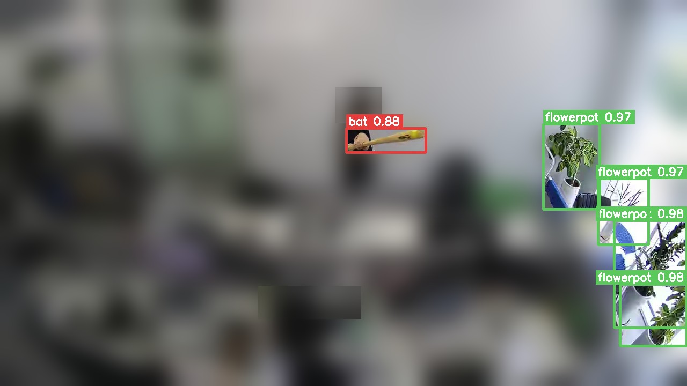

# CCTV 화분·야구방망이 탐지 (POTBAT)

배포 카메라 영상(학습에 쓰지 않은 구간)에 모델을 돌린 결과입니다. 사람이 드러나지 않도록 탐지된 물체 칸 밖은 흐리게,
사람 머리 근처는 한 번 더 흐리게 처리했습니다.

CCTV에서 **화분과 야구방망이**를 잡는 2클래스 경량 탐지 모델(YOLO12n, 5.3MB)입니다.
운영 시스템의 비어 있던 2차 모델 슬롯에 연결해 **운영 코드는 한 줄도 고치지 않고** 탑재했습니다.
앞선 걷기·서기 판정에서 26일 동안 다져 둔 학습 전략·평가 방법을 재사용해 **1일 만에** 끝냈습니다.

> 사내 프로젝트라 소스 코드와 데이터는 공개하지 않습니다.

## 한눈에

| | |
|---|---|
| 기간 | 2026년 7월 말 (1일) |
| 역할 | 데이터 조사·수집, 사전 라벨링·검수, 학습, 평가, 운영 연동 |
| 결과 | 방망이를 놓치는 비율 **44% → 14%**, 범용 탐지 성능 손실 없음 |
| 측정 | 배포 카메라 영상 380프레임(방망이 274박스) — 학습에 쓰지 않은 영상 |

## 성능

| | 1차 배포 | 최종 | 변화 |
|---|---|---|---|
| 방망이 AP50 | 0.597 | **0.852** | +0.255 |
| **방망이 재현율** | 0.558 | **0.861** | **+0.303** |
| 방망이 정밀도 | 0.652 | 0.829 | +0.177 |
| 범용 탐지 성능 | 0.561 | 0.565 | +0.004 |

운영 조건에서 재면, 방망이가 보이는 3초 구간을 놓치지 않을 확률이 **99.7%**, 방망이가 없는 영상에서 잘못 잡는
빈도는 **분당 0.95프레임**입니다.

범용 탐지 성능 0.565는 낮아 보이지만, 원래 사전학습 모델의 같은 조건 점수가 **0.535**입니다.
원래 어려운 조건이었고 이 모델이 오히려 높습니다 — 기준선을 재기 전에는 해석할 수 없는 숫자였습니다.

## 만들면서 한 판단

**공개 데이터가 없다는 것부터 셌다.** 화분은 충분했지만 방망이는 사실상 없었습니다. 공개 데이터의 방망이는 거의
야구 경기 장면이라 CCTV 속 사람이 휘두르는 장면과 다릅니다. 화분을 더 모으면 불균형만 커지므로 추가 수집을 멈췄습니다.

**큰 모델로 초안을 뽑고 사람이 검수했다.** 대형 모델의 방망이 탐지율(58~70%)이 경량 모델(12~29%)보다 충분히
높은 것을 먼저 재서 사전 라벨링이 쓸 만한지 확인했습니다. 대형 모델은 라벨링 도구로만 쓰고 배포하지 않습니다.

**AP50 0.897이 배포 카메라에서는 0.597이었다.** 1차 배포 때의 평가셋이 학습에 쓴 영상의 뒷부분이었습니다.
그 뒤로는 학습에 오후 3시대, 검증에 오후 1시대 영상을 써서 **같은 카메라의 다른 세션**으로 나눴고, 그래야 최종
0.852가 실제 개선인지 확인할 수 있었습니다.

**자동 선정 결과를 사람이 뒤집었다.** 선정 스크립트는 AP50이 가장 높은 안을 골랐지만, 두 안의 AP50 차이는
0.001(잡음 수준)이고 재현율 차이는 0.087이었습니다. 보안 용도에서는 놓치는 것이 잘못 잡는 것보다 치명적이라
재현율이 높은 안을 택했습니다. 자동화는 기준이 맞을 때만 유효합니다.

**실전 성능을 만든 것은 배포 카메라 자체의 데이터였다.** 운영 서버가 이미 1분 단위로 쌓던 원본 영상을 학습에
넣은 것이 개선의 대부분을 만들었습니다.

## 한계

- **놓여 있는 방망이는 약합니다.** 학습 데이터의 방망이가 전부 사람과 함께 찍혀 있어, 모델이 "사람 손 근처의
  긴 막대"를 배웠습니다. 사람 없이 방망이만 두고 1~2분 찍으면 해결되는 문제로 확인했습니다.
- 카메라 1대에서만 검증했습니다.
