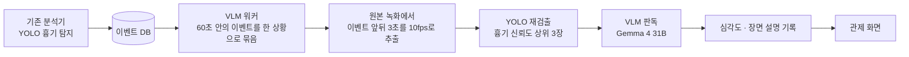

# CCTV 흉기 탐지 VLM 2차 판독

`Python` `Ollama` `Gemma 4 31B` `Qwen2.5-VL 7B` `YOLO` `ffmpeg` · 2026.08 · 측정, 모델 비교, 운영 워커 개발

운영 중인 CCTV 관제 시스템에서 흉기 탐지 모델(YOLO)이 칼을 잡으면, 사내 GPU 서버의 VLM이 그 장면을 다시 보고 실제 칼인지 확인해 알람 등급을 나누는 워커입니다.
모든 이벤트에는 장면을 한 문장으로 설명하는 글도 붙여서, 관제 요원이 영상을 열기 전에 상황을 알 수 있게 했습니다.

- 붙이기 전에 효과부터 측정: 운영 DB 실데이터(13,956행, 검출 138,133개)로 계획에 있던 설계 전제 2개를 반증
- 사무실 오탐 218건을 "흉기 아님"으로 판독 (Qwen2.5-VL 7B 33.5% → Gemma 4 31B 100%). 단, 아래 이유로 판별력 100%는 아님
- 진짜 칼을 놓치던 원인을 VLM이 아니라 스냅샷 저장 단계에서 찾음: 저장 스냅샷 재검출 0/9 → 원본 녹화에서 프레임 되찾기 6/6
- 기존 분석기 코드 수정 0, DB 스키마 변경 0, 저장 용량 증가 0, 외부 API 비용 0

사내 프로젝트라 코드는 공개하지 않습니다. 카메라 장면에는 사람이 나와서 사진은 넣지 않았습니다.

## 구조

| 등급 | 조건 |
|---|---|
| critical | 흉기 탐지, VLM도 흉기로 판독 |
| major | 흉기 탐지, VLM은 흉기가 아니라고 판독. 사람이 확인 |
| minor | 업무시간 외 사람 |
| info | 일상 활동 |

VLM이 흉기가 아니라고 해도 알람을 지우지 않고 한 단계 내립니다. VLM도 틀리기 때문입니다. 실제로 측정 중에 진짜 칼을 "휴대폰"으로 판독한 사례가 나왔고, 지우지 않고 내리는 구조여서 알람이 남았습니다.

프롬프트에는 "판단이 어려우면 흉기로 둔다", "모르면 '판별 불가'라고 답한다"를 넣었습니다. 놓치는 것보다 사람이 한 번 더 보는 편이 낫고, 모르는 걸 모른다고 답하게 해야 실패가 조용히 지나가지 않습니다.

## 만들면서 있었던 일

처음 계획에서 VLM의 효과는 경쟁사 발표 수치에 기댄 가정이었습니다. 붙인 뒤에 효과가 없으면 되돌리는 비용이 커서, 운영 DB의 실데이터로 먼저 쟀습니다. Qwen2.5-VL 7B로 사무실 오탐 218건 중 73건(33.5%)을 걸러 냈습니다. 그리고 계획에 있던 설계 두 개가 깨졌습니다. 신뢰도 35~75% 구간만 VLM에 보내려던 안은, 진짜 칼과 휴대폰 오탐의 신뢰도가 같은 구간에 겹쳐 있어서 쓸 수 없었습니다(칼 검출의 82.9%가 이 구간). 응답 제한 1.5초는 29%가 넘겨서 검증 없이 통과될 뻔했습니다. 또 오탐 대부분은 2주 전에 검출 모델을 바꾸면서 이미 사라져 있었습니다(칼 검출 하루 538건 → 7건).

모델은 같은 대상, 같은 프롬프트, 같은 정답 기준에서 모델만 바꿔 비교했습니다.

| | Qwen2.5-VL 7B | Gemma 4 31B |
|---|---:|---:|
| 사무실 오탐 걸러내기 | 33.5% | 100% (218/218) |
| 놓친 프레임 판독 (원본 영상) | 10/21 | 13/21 |
| 장면 설명 JSON 형식 | 19/20 | 20/20 |
| 화면 끝에 잘린 사람을 "판독 근거 불충분"으로 | 0/3 | 3/3 |
| 응답 시간 | 1.5초 | 3.1초 |

더 큰 텍스트 모델(gpt-oss 120B)도 시험했는데, 흉기 판독에 빈 응답만 돌아왔습니다. 스냅샷 왼쪽 위에 찍힌 날짜를 읽게 하는 대조 질문을 따로 넣어 보니 "이미지 없음"이라고 답했고, 입력 토큰도 126개로 이미지가 빠져 있었습니다(Gemma는 329개). 오류 없이 이미지를 무시하는 모델이라, 대조 질문이 없었다면 원인을 몰랐을 겁니다.

그런데 Gemma의 100%를 다시 보니, 야외에서 찍힌 진짜 칼도 하나도 잡지 못하고 있었습니다(0/5). 모델 크기, 이미지 확대, 사람 부분만 잘라 확대하기, 프롬프트 바꾸기를 차례로 시험했지만 모두 그대로였습니다. 원인은 저장 단계였습니다. 저장할 때 칼 73~76%로 잡힌 바로 그 스냅샷에 같은 탐지기를 다시 돌렸더니 칼이 하나도 나오지 않았습니다. 960×540으로 줄이고 JPEG로 압축하는 과정에서 칼 픽셀이 사라지고 있었습니다. 그러니 100%는 "칼이 보이지 않는 장면을 모두 걸렀다"는 뜻이었고, 칼과 칼이 아닌 것을 가려낸 결과가 아니었습니다. 이걸 확인한 뒤 흉기 판독을 껐습니다.

원본 녹화(1280×720)는 이미 따로 저장되고 있었습니다. 그래서 이벤트 앞뒤 3초를 녹화에서 다시 뽑기로 했는데, 처음 두 번은 실패했습니다. 이벤트 시각으로 한 장만 뽑았을 때는 0/4, 0.5초 간격으로 훑었을 때는 2/4였습니다. 원인은 시각 계산이었습니다. 녹화 파일 이름에는 시작 '분'만 있고, 실제 파일은 키프레임 경계에서 잘려 길이가 42~67초로 제각각이었습니다. 파일 수정 시각에서 길이를 빼 실제 시작 시각을 구하고 10fps로 훑게 바꾸자 6/6을 되찾았습니다. 이 프레임으로 다시 판독해 보니, 저장 스냅샷으로는 "휴대폰"이라 major로 내려가던 상황이 녹화본의 두 번째 프레임에서 칼로 판독돼 critical로 유지됐습니다. 첫 프레임은 "판별 불가"였기 때문에, 한 장이 아니라 여러 장을 보는 구조가 여기서 효과를 냈습니다.

탐지기가 놓친 구간을 VLM이 주기적으로 훑어 보완하는 안도 검토했습니다. 기존 데이터로 시뮬레이션해 보니, YOLO가 통째로 놓친 구간에서 VLM이 건진 비율은 0%였습니다. YOLO가 놓치는 구간은 애초에 칼이 잘 보이지 않는 구간이라, VLM도 같은 이유로 보지 못했습니다. 두 모델의 실패가 서로 독립이 아니어서 이 안은 접었고, 놓친 프레임 21장은 검출 모델 재학습 데이터로 남겼습니다.

## 지금 상태

- 워커는 운영 서버에 배포했지만, 상시 실행이 아니라 수동으로 돌리고 있습니다(2026-08-12 기준). 녹화 보관이 약 6일이라 녹화본에서 프레임을 되찾으려면 상시 실행이 필요합니다.
- 녹화본에서 되찾은 프레임으로 VLM 판독까지 확인한 건 시운전 1개 상황입니다. 진짜 칼에 대한 판별력은 표본이 작아 아직 수치로 말할 수 없습니다.
- 흉기 이벤트가 하루 0~1건이라 비용은 작습니다(이벤트당 CPU 약 46초, 사내 서버라 토큰 비용 0). 같은 이유로 평가 표본도 작습니다.
- 이번 일에서 오탐을 가장 크게 줄인 건 VLM이 아니라 검출 모델 교체였습니다.
