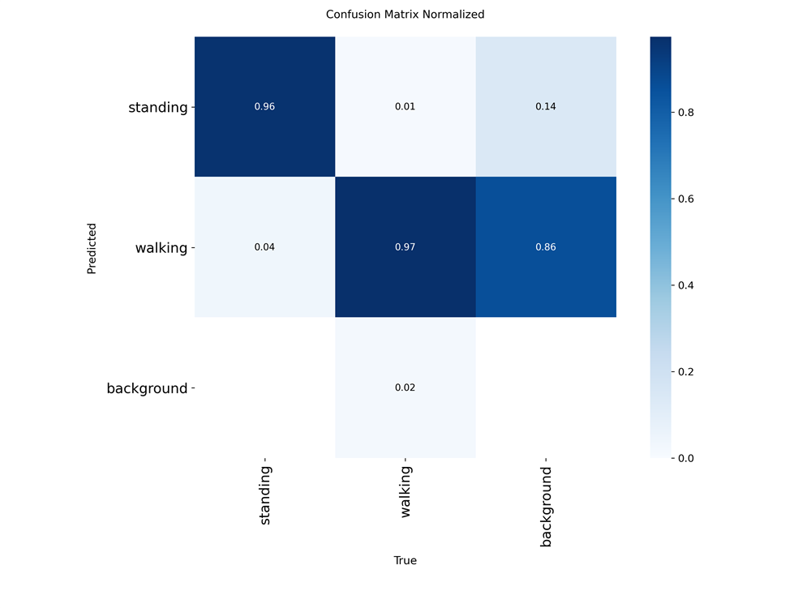

# CCTV 걷기·서기 판정 (WALKSTAND)

운영 중인 CCTV 관제 시스템에서 사람이 **걷고 있는지 서 있는지** 판정하는 기능입니다.
전용 분류 모델을 만들어 배포했다가, 측정을 다시 해 보고 **제거하는 쪽이 답**이라는 결론을 냈습니다.
지금은 기존 흉기 탐지 모델이 이미 잡아 둔 사람 박스의 **프레임 간 이동량**으로 판정해 추가 연산이 0입니다.

> 사내 프로젝트라 소스 코드와 데이터는 공개하지 않습니다.

## 한눈에

| | |
|---|---|
| 기간 | 2026년 7월 (약 26일) |
| 역할 | 데이터 수집·라벨링, 학습, 평가 체계 구축, 운영 시스템 연동 |
| 결과 | 균형 정확도 **75.5%** (아무것도 안 하는 기준선 50%), **추가 연산 0** |
| 정답 데이터 | 사람이 직접 검수한 2,818박스 (16개 클립, 171구간) |
| 제약 | 기존 흉기 탐지는 건드리지 않는다 — 확장 슬롯과 읽기 전용 경로만 사용 |

## 성능

| 설정 | 정확도 | 균형 정확도 | 서기 | 걷기 |
|---|---|---|---|---|
| 운영값 | 72.2% | **75.5%** | 82.5% | 68.5% |
| *(기준선) 전부 "걷기"로 답하기* | *73.6%* | *50.0%* | *0%* | *100%* |

정답의 73.6%가 걷기라서, 정확도만 보면 **아무 판단도 하지 않는 쪽이 이깁니다.**
그래서 두 클래스를 같은 무게로 보는 균형 정확도로 읽습니다.

## 좋은 점수가 두 번 가짜였다

전용 모델을 학습할 때 나온 평가 결과입니다. 서기 96%·걷기 97%로 보였지만, 아래 이유로 부풀려진 점수였습니다.

**1. 검증 정확도 100%인데 걷는 사람의 90%를 놓쳤다.**
사람 이미지를 잘라 자세로 분류하는 방식을 세 가지 구조로 시도했고, 마지막 시도는 검증 정확도 100%였습니다.
새 영상에서는 걷는 사람의 90%를 놓쳤습니다. 걷기는 야외, 서기는 실내에서 찍힌 데이터라
모델이 자세가 아니라 **배경을 학습**했던 것입니다. 여기서 더 중요한 사실을 확인했습니다 —
**정지 영상 한 장에는 걷기와 서기를 구분할 정보가 원리적으로 없습니다.** 걷는 도중의 자세와 서 있는 자세는
한 장에서 같습니다. 그래서 프레임 사이의 움직임을 보는 구조로 바꿨습니다.

**2. mAP 0.98 모델의 실제 서기 재현율이 31%였다.**
학습셋과 평가셋이 같은 영상에서 몇 초 간격으로 잘라낸 프레임이라, 사실상 같은 장면으로 채점하고 있었습니다.
라이브 영상으로 다시 재니 서기 재현율이 96%에서 **31%** 로 떨어졌습니다.

## 가장 큰 개선은 코드를 지워서 나왔다

후처리 조정으로 덮으려다 한계에 닿았을 때 구조를 다시 봤습니다.
**최종 판정은 이미 박스 이동량이 하고 있었고, 전용 모델이 실제로 하는 일은 사람 박스를 공급하는 것뿐**이었습니다.
그 일을 더 잘하는 모델(기존 흉기 탐지 모델)이 이미 같은 프레임을 처리하고 있었습니다.

전용 모델을 빼고 기존 모델의 사람 박스를 재사용하도록 바꾸자 판정 편향이 사라지고, 추적이 안정되고,
GPU 부하가 줄고, 재학습이 필요 없어졌습니다. 같은 영상에서 기존 모델이 사람 박스 226개를 잡는 동안
전용 모델은 71개만 잡았고, **창가에 서 있는 사람을 통째로 놓치고** 있었습니다.

## 평가 체계

같은 판정을 세 층으로 나눠 측정했습니다. 하나만 보면 어디서 틀렸는지 알 수 없기 때문입니다.

| 층 | 무엇을 재나 |
|---|---|
| 프레임 단위 | 모델이 사람을 제대로 잡는가 |
| 이동량 | 판정 로직이 걷기·서기를 맞게 가르는가 |
| 최종 출력 | 스무딩·상태 전이를 거친 뒤 사용자가 보는 결과 |

판정할 수 없는 구간(추적 시작 직후 약 0.5초, 너무 작아 앉은 사람과 구분되지 않는 박스)은 억지로 맞히지 않고
"사람"으로만 표시합니다.

## 한계

- 카메라 1대에서만 검증했습니다. 다른 각도·조도·배치에서의 성능은 측정하지 않았습니다.
- 사람 박스를 흉기 탐지 모델에서 받으므로, 그쪽 임계값이 바뀌면 그대로 영향을 받습니다.
- 스무딩 값이 16개 클립에 맞춰져 있어 다른 영상에서는 다시 맞춰야 할 수 있습니다.
