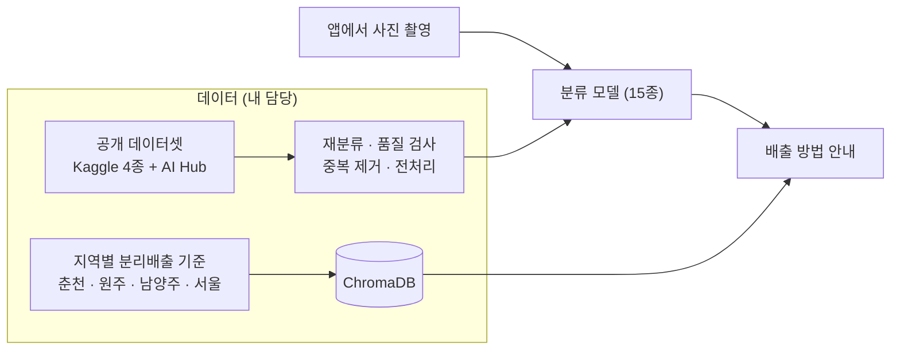

# 쓰레기 분류·재활용 가이드 앱

`Python` `PyTorch` `ChromaDB` · 2025.03~06 · 4인 팀, 데이터 담당

사진을 찍으면 쓰레기 종류를 분류하고, 사는 지역의 분리배출 기준에 맞춰 버리는 방법을 알려 주는 앱입니다. 2025년 1학기 소프트웨어 캡스톤 디자인 팀 프로젝트로 만들었습니다.

| | |
|---|---|
| 맡은 일 | 4인 팀 중 데이터 담당. 분류 모델 학습 데이터와 분리배출 안내 문서를 만들고, 분류 모델 학습에도 일부 참여 |
| 개발 방식 | 데이터 분류와 검수는 직접 하고, 크롤링 코드 작성에는 AI 도구(Gemini)를 씀 |
| 결과 | 15종 분류 데이터셋 약 14,600장 구축(그중 약 1만 장은 직접 다시 분류). 팀 모델 시험 정확도 85%(2,924장). 한림대학교 캡스톤 디자인 경진대회 동상 |
| 핵심 판단 | 직접 만든 크롤링 데이터를 저작권 때문에 쓰지 않고 공개 데이터셋으로 바꿈 |
| 안내 데이터 | 춘천·원주·남양주·서울의 분리배출 기준 82개 품목을 "종류 → 세부 품목 → 배출 방법"으로 정리해 ChromaDB 검색으로 답하게 함 |
| 지금 상태 | 학기 프로젝트로 마침 |

앱은 Flutter, 서버는 Django(분류 모델 서빙, 분리배출 안내 검색)로 만들었습니다.

코드: [tommyoon0827/CapstoneDesign](https://github.com/tommyoon0827/CapstoneDesign)

## 왜 이렇게 정했나

- **크롤링 데이터를 버림.** 검색어를 바꿔 가며 모으고 중복과 흐린 이미지를 거르는 파이프라인까지 만들었지만, 저작권 문제가 있어서 쓰지 않기로 하고 공개 데이터셋(Kaggle 4종, AI Hub)으로 바꿨습니다.
- **분류는 직접 다시 함.** 공개 데이터셋은 분류가 정확하지 않았고, 사전학습 모델로 자동 분류를 해 봐도 제대로 가르지 못했습니다. 그래서 약 1만 장을 직접 다시 분류했습니다.
- **크기를 맞출 때 비율을 지킴.** 224×224로 맞출 때 늘리지 않고 남는 부분을 패딩으로 채웠습니다. 늘리면 물건 모양이 바뀌어서입니다.

## 구조

<!-- 사진 넣는 법: 사진 파일을 docs/ 폴더에 아래 이름으로 넣고, 각 사진 줄 앞뒤의 주석 기호를 지우세요. -->

<!--  -->

<!--  -->

데이터를 만들며 있었던 일

 

분류 15종: 고철, 비닐, 상자, 소형폐가전, 스티로폼, 신문지, 유리, 음식물, 의류, 전자제품, 전지류, 책자, 캔류, 플라스틱, 형광등

처음에는 웹에서 이미지를 모으는 파이프라인을 만들었습니다. 카테고리마다 검색어를 여러 갈래로 바꿔 가며 모으고, 해시로 중복을 지우고, 흐리거나 검은 이미지를 걸러 내고, 부족한 클래스는 다시 모으는 식이었습니다. 하지만 저작권 문제가 있어서 크롤링한 데이터는 쓰지 않기로 하고, 공개 데이터셋(Kaggle 4종, AI Hub 재활용품 분류·선별 데이터)을 조합하는 쪽으로 바꿨습니다.

가져온 공개 데이터셋은 분류가 정확하지 않았습니다. 사전학습 모델로 자동 분류를 먼저 해 봤는데 제대로 가르지 못해서, 직접 다시 분류했습니다.

전처리는 깨진 파일 검사, MD5로 중복 제거, 224×224 크기 맞춤(비율을 유지하고 남는 부분은 패딩)을 한 번에 돌리도록 묶었습니다.

분리배출 기준은 지자체마다 다릅니다. 춘천, 원주, 남양주, 서울의 기준을 "종류 → 세부 품목 → 배출 방법" 순서로 정리해 문서로 만들고, ChromaDB에 넣어서 검색 결과로 답하게 했습니다.

지금 상태와 한계

 

- 학기 프로젝트로 마쳤고, 서비스로 운영하지는 않았습니다.
- 분리배출 안내는 4개 시 기준만 담았습니다.
- 팀 모델은 검증 정확도 95%, 시험 정확도 85%로 차이가 컸는데, 그 원인은 그때 분석하지 못했습니다.

<!--  -->
