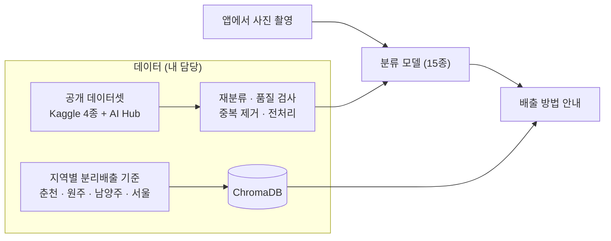

# 쓰레기 분류·재활용 가이드 앱 (캡스톤 디자인)

사진을 찍으면 쓰레기 종류를 분류하고, **사는 지역의 분리배출 기준**에 맞춰 버리는 방법을 알려 주는 앱입니다.
2025년 1학기 소프트웨어 캡스톤 디자인 팀 프로젝트로, **한림대학교 캡스톤 디자인 경진대회 동상**을 받았습니다.
4명이 함께 만들었고 저는 **데이터**를 맡았습니다.

→ 코드: [tommyoon0827/CapstoneDesign](https://github.com/tommyoon0827/CapstoneDesign)

## 한눈에

| | |
|---|---|
| 기간 | 2025년 3~6월 |
| 팀 | 4명 |
| 구성 | Flutter 앱 · Django 서버(분류 모델 서빙, 분리배출 안내 검색) |
| 내 역할 | 데이터 엔지니어 — 분류 모델 학습 데이터 준비, 분리배출 안내용 문서 데이터 구축 |
| 분류 | 15종 (고철·비닐·상자·소형폐가전·스티로폼·신문지·유리·음식물·의류·전자제품·전지류·책자·캔류·플라스틱·형광등) |
| 수상 | 한림대학교 캡스톤 디자인 경진대회 동상 |

## 구조

<!-- 사진 넣는 자리: 사진 파일을 docs/ 폴더에 아래 이름으로 넣고, 해당 줄을 감싼 주석 기호를 지우세요.
## 화면

### 사진 촬영 · 분류 결과

### 지역별 배출 방법 안내

### 경진대회 (선택)

-->

## 데이터를 만들며 한 판단

**크롤링 대신 공개 데이터셋으로 바꿨다.** 처음에는 카테고리마다 검색어를 여러 갈래로 바꿔 가며 이미지를 웹에서
모으는 파이프라인을 만들었습니다(해시로 중복 제거, 흐리거나 검은 이미지 걸러내기, 부족한 클래스 재수집).
하지만 저작권 문제가 있어 크롤링한 데이터는 쓰지 않기로 결정하고, 공개 데이터셋(Kaggle 4종, AI Hub 재활용품
분류·선별 데이터)을 조합하는 쪽으로 바꿨습니다.

**공개 데이터의 분류를 그대로 믿지 않았다.** 가져온 데이터셋 안의 분류가 정확하지 않았습니다.
사전학습 모델로 자동 분류를 먼저 시도했지만 정확하게 가르지 못해, 직접 다시 분류해 모델이 배울 데이터의
정확도를 높였습니다.

**전처리를 파이프라인으로 묶었다.** 깨진 파일 검사, MD5로 중복 제거, 224×224 크기 맞춤(비율 유지 패딩)을
한 번에 돌리도록 정리했습니다.

**안내 문구는 지역별로 구조화했다.** 분리배출 기준은 지자체마다 다릅니다. 춘천·원주·남양주·서울의 기준을
"종류 → 세부 품목 → 배출 방법" 구조로 정리해 문서로 만들고, ChromaDB에 넣어 검색으로 답하게 했습니다.
